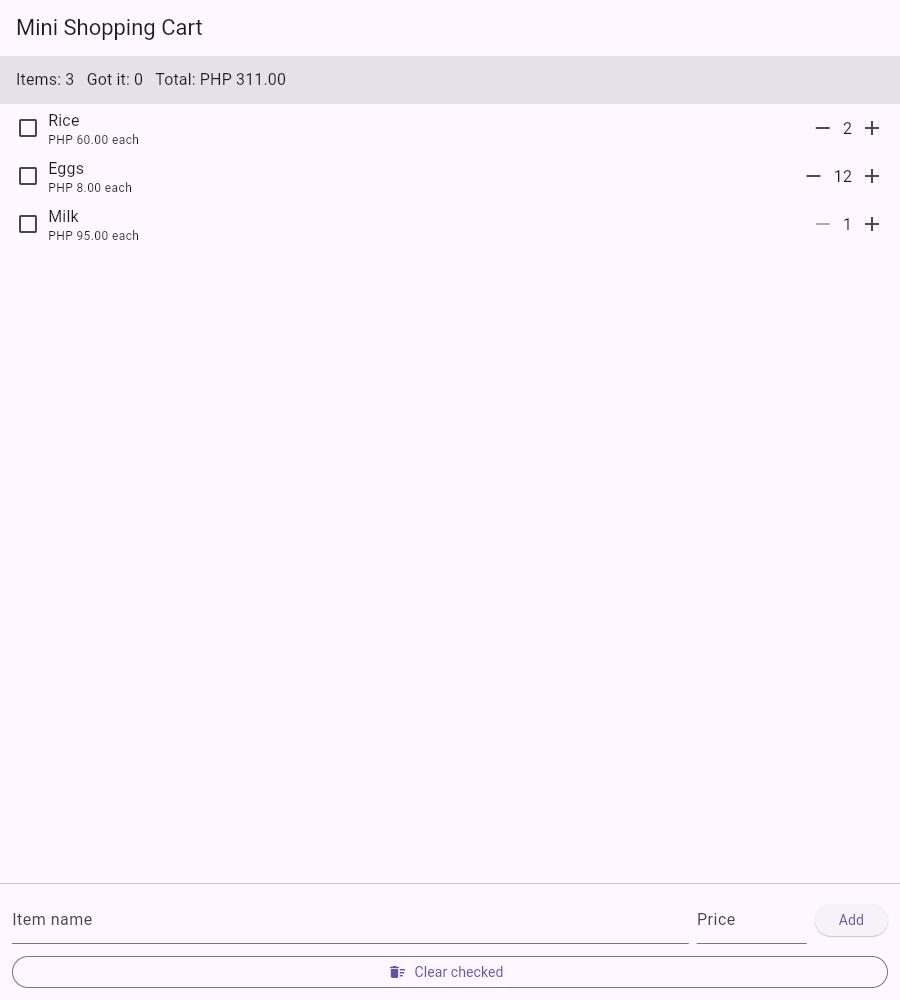

# Mini Shopping Cart — Stateful Lab

**Name:** Jay Aguelo
**Activity:** Stateful Widgets Laboratory (Flutter)

A one-screen shopping cart built with Flutter. The screen is a
`StatefulWidget` (`CartScreen`) whose State owns the cart data, while each row
is a stateless `CartItemTile` that only receives data and callbacks.



## What the app does

- Preloads 3 sample items in `initState()`
- Live summary bar: `Items: N`, `Got it: M` and `Total: PHP X.XX`
- Per-item quantity controls with limits (minimum 1, maximum 99)
- A "got it" checkbox that strikes the item name through
- Add-item form with validation (name required, price must be a number > 0)
- "Clear checked" removes every ticked item
- Both `TextEditingController`s are disposed in `dispose()`
- Every change to the cart happens inside `setState()`

## How to run it

```bash
flutter pub get
flutter run
```

## How to run the tests

```bash
flutter test
```

## Project layout

| File | Purpose |
| --- | --- |
| `lib/main.dart` | `CartItem` model, `CartScreen` (stateful parent), `CartItemTile` (stateless child) |
| `test/cart_test.dart` | Widget tests for the cart behaviour and form validation |
| `screenshots/app.png` | Screenshot of the running app |
